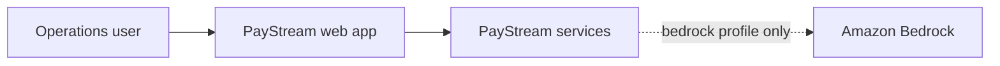
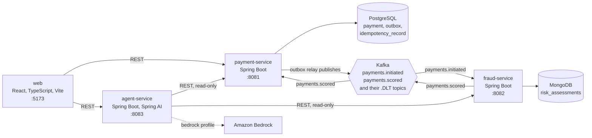

# PayStream architecture

This document describes the system as the code stands today. Planned work is marked **Planned** and points to a roadmap step in `README.md`. For how a payment moves through the system step by step, see `PROJECT-WORKFLOW.md`.

Status on 2026-11-14: the Java services are written but have not yet been compiled or run. Treat every runtime claim below as the design intent until `mvn verify` and a local run confirm it.

## 1. Purpose and scope

PayStream accepts payment instructions, scores each one for fraud risk asynchronously, and lets an operations user ask an AI agent why a payment was approved or held.

In scope: payment intake, risk scoring, status tracking, read-only agent triage.
Out of scope: moving money, settlement, ledgers, customer authentication, real fraud models.

## 2. System context

There is one user role today: an operations user with full access. There is no authentication yet (**Planned**, step 14).

## 3. Containers

| Container | Responsibility | Owns | Talks to |
|---|---|---|---|
| `web` | Payment form, live payment table, agent panel | Nothing | `payment-service`, `agent-service` over REST through the Vite dev proxy |
| `payment-service` | System of record for payments; publishes payment events; applies scores | PostgreSQL schema | Kafka (produce and consume) |
| `fraud-service` | Scores each payment with five configurable rules; stores assessments with the rules that fired | MongoDB collection | Kafka (consume and produce) |
| `agent-service` | Answers questions about payments through tools; files hold requests for human approval; audits tool calls | Approval requests and conversation memory, both in memory only | `payment-service` and `fraud-service` over REST; Bedrock when enabled |

Rules that hold across the system:

- One writer per data store. No service reads another service's database.
- Services share event contracts, not code. Each keeps its own copy of the event records.
- `payment-service` and `fraud-service` never call each other synchronously. They communicate only through Kafka.

## 4. Technology

| Area | Choice |
|---|---|
| Language and framework | Java 21, Spring Boot 3.5.6 (pinned from memory; verify) |
| Build | Maven multi-module (`payment-service`, `fraud-service`, `agent-service`) |
| Messaging | Apache Kafka 3.9, KRaft mode, single local broker; Spring for Apache Kafka |
| Relational store | PostgreSQL 16, Spring Data JPA, Flyway migrations |
| Document store | MongoDB 7, Spring Data MongoDB |
| AI | Spring AI 1.1.0 (verify), Amazon Bedrock Converse API |
| Frontend | React 18, TypeScript (strict), Vite 5 |
| Delivery | Docker multi-stage build, Docker Compose for infrastructure, Helm chart for one service, GitHub Actions |

## 5. Event contracts

Payloads are JSON strings today. **Planned**, step 5: Avro or JSON Schema with a schema registry.

| Topic | Key | Producer | Consumer group | Payload fields |
|---|---|---|---|---|
| `payments.initiated` | payment ID | `payment-service` (outbox relay) | `fraud-service` | `paymentId`, `debtorAccount`, `creditorAccount`, `amount`, `currency`, `occurredAt` |
| `payments.scored` | payment ID | `fraud-service` | `payment-service` | `paymentId`, `score`, `decision`, `reason`, `scoredAt` |
| `payments.initiated.DLT` | payment ID | `fraud-service` error handler | none yet | The failed record, with the exception in headers |
| `payments.scored.DLT` | payment ID | `payment-service` error handler | none yet | The failed record, with the exception in headers |

Each topic has 3 partitions and replication factor 1 locally. Keying by payment ID keeps all events for one payment on one partition, in order.

## 6. Data model

**PostgreSQL, owned by `payment-service`**

| Table | Purpose | Key columns |
|---|---|---|
| `payment` | The payment and its current status | `id` (UUID), `status` (`INITIATED`, `APPROVED`, `FLAGGED`, `ON_HOLD`), `hold_reason`, `held_at`, `risk_score`, `risk_reason`, `version` for optimistic locking |
| `outbox` | Events waiting to be published | `id` (sequence, gives publish order), `topic`, `aggregate_id`, `payload`, `sent_at` (null until published) |
| `idempotency_record` | One row per client idempotency key | `idem_key` (primary key), `payment_id`, `request_hash` |

**MongoDB, owned by `fraud-service`**

| Collection | Purpose | Document ID |
|---|---|---|
| `risk_assessments` | Score, decision, reason, embedded list of rule hits, debtor account and event time per payment | The payment ID, so reprocessing overwrites instead of duplicating |

A compound index on `debtorAccount` and `occurredAt` serves the velocity rule's count.

## 7. Key design decisions

| Decision | Why | Cost | Record |
|---|---|---|---|
| Transactional outbox with a polling relay | A payment and its event are committed together; no event is lost if the process dies | Up to 500 ms publish delay; outbox table grows | ADR 0002 |
| Blocking retry, then dead-letter topic | One poison record cannot block a partition for long; order per payment is kept | Up to 3.5 s partition stall per bad record | ADR 0002 |
| Idempotency key stored with the payment | A client retry cannot create a second payment, even under a race | One extra row and lookup per request | ADR 0002 |
| Asynchronous scoring over Kafka | Payment intake stays available when scoring is slow or down | Status is eventually consistent; the UI shows `INITIATED` briefly | This document |
| MongoDB for risk assessments | Assessment shape changes as rules grow; rule hits embed naturally; lookups are by payment ID or by debtor and time | A second database engine to run | This document |
| `fraud-service` publishes synchronously instead of using an outbox | The input record can always be reprocessed, so a failed publish just retries | One blocking send per record limits throughput | ADR 0003 |
| Fraud rules as strategy beans with configured thresholds | A new rule is a new class; a threshold change is configuration | More classes than one method | ADR 0003 |
| Velocity counted in MongoDB | Simple, works across instances | Approximate under concurrency | ADR 0003 |
| Agent behind an `AgentBrain` port with an offline stub | Builds and tests need no AWS account and cost nothing | The stub is not a model; behaviour differs from Bedrock | ADR 0001 |
| The agent can read and propose; only a human can act | A wrong or manipulated model cannot change a payment | Every hold needs a human click | ADR 0004 |
| Guardrails, argument validation and tool-call audit are code outside the model | A model cannot be talked out of code | The phrase-list guardrail is basic | ADR 0004 |
| Bedrock failures fall back to the stub | An outage degrades the agent instead of removing it | Fallback answers are cruder | ADR 0004 |

## 8. Delivery guarantees and consistency

- **Payment to event:** atomic, through the outbox.
- **Outbox to Kafka:** at-least-once. A row can be published twice if the database commit fails after the broker acknowledges.
- **Kafka to consumers:** at-least-once. Both consumers are idempotent: `fraud-service` upserts by payment ID, and `Payment.applyScore` sets the same values on a repeat.
- **Score publication:** `fraud-service` commits its offset only after the broker acknowledges the score, so a score is never silently lost.
- **Ordering:** per payment only, by partition key.
- **Read consistency:** a payment read immediately after creation is `INITIATED` with no score. The score arrives typically within a second of the relay's next poll.

## 9. Failure modes

| Failure | What happens today | Gap |
|---|---|---|
| Kafka down when a payment is created | Payment and outbox row commit; the relay retries every 500 ms until Kafka returns | No alert on a growing outbox |
| `payment-service` dies after commit, before publish | The row is still unsent; the relay publishes it on restart | None |
| Malformed `payments.scored` record | Sent straight to `payments.scored.DLT`; consumer continues | Nobody reads the DLT |
| Database error while applying a score | Retried 3 times with backoff, then dead-lettered | Payment stays `INITIATED` with no alert |
| Malformed or incomplete `payments.initiated` record | Sent straight to `payments.initiated.DLT`; consumer continues | Nobody reads the DLT; the payment stays `INITIATED` |
| MongoDB down while scoring | Retried 3 times with backoff, then dead-lettered | Payment stays `INITIATED` with no alert |
| `fraud-service` down | Events wait in Kafka; payments stay `INITIATED` until it returns | No timeout or fallback decision |
| `fraud-service` saves the assessment, then fails to publish | The listener throws, the record is retried, the upsert and publish repeat | After 3 failed retries the record is dead-lettered |
| Two payments from one debtor scored at the same instant | Each velocity count can miss the other | Exact counting needs Kafka Streams (step 6) |
| Same request sent twice with one key | Second call returns the original payment | Keys never expire |
| Agent's downstream call fails or is slow | Connect timeout 1 s, read timeout 2 s; the tool returns an error as data and the agent says what it could not find | No retry or circuit breaker (**Planned**, step 4) |
| Bedrock call fails (throttling, credentials, model access) | The stub answers; the reply is labelled `stub (Bedrock unavailable)` | No alert; no retry with backoff |
| User message contains an injection phrase or a card number | Refused, or the number is masked, before any brain runs | Phrase list is easy to evade |
| Tool output contains injected instructions | The system prompt tells the model to treat tool output as data | That is a request, not a control (step 8) |
| A hold request is approved | `agent-service` calls the hold endpoint; a `FLAGGED` payment becomes `ON_HOLD`; repeating the call is harmless | No event is published for the hold; a held payment cannot be released |
| The hold call fails after approval | The approval stays `APPROVED` with the failure in its outcome text; the payment is not held | No retry or re-run (step 8) |
| A score event is replayed after a hold | The score is updated; the status stays `ON_HOLD` | None |
| `agent-service` restarts | Pending approvals and conversation memory are lost | Persist both (steps 7 and 8) |

## 10. Cross-cutting concerns

| Concern | Today | Planned |
|---|---|---|
| Security | None. All endpoints are open, including approve and reject. Database credentials are defaults in configuration. | OAuth2 resource server, secrets management (step 14) |
| AI controls | Input guardrail, number masking, validated tool arguments, human approval for actions, tool-call trace in the reply and the log | Bedrock Guardrails, tool-result screening, evaluation set, token budgets (steps 7 and 8) |
| Observability | Actuator health, liveness and readiness probes, basic metrics | Prometheus, Grafana, OpenTelemetry tracing across the Kafka hop (step 14) |
| Error contract | `payment-service` returns problem-detail JSON | The other two services (step 4) |
| Resilience | Kafka retries and dead-letter topics in both event-driven services | Resilience4j on HTTP calls (step 4) |
| Testing | Unit tests only | Testcontainers integration tests (steps 1 to 3 exercises, step 11) |

## 11. Deployment

**Today:** Kafka, PostgreSQL and MongoDB run in Docker Compose. The three services and the web app run on the developer machine.

**Planned:** all services in Compose (step 10), Kubernetes through Helm with probes, autoscaling and disruption budgets (step 12), AWS through Terraform (step 13).

Scaling notes for when you get there: `payment-service` and `fraud-service` are stateless and scale horizontally. Consumer parallelism is capped at 3 by the partition count. Several `payment-service` instances can run the outbox relay together because it locks rows with `SKIP LOCKED`.

## 12. Known gaps

- Nothing has been compiled or run end to end.
- No authentication or authorisation anywhere.
- No integration tests.
- Nobody consumes either dead-letter topic.
- The velocity rule is approximate under concurrency.
- A payment whose scoring fails permanently stays `INITIATED` with no timeout.
- No clean-up for sent outbox rows or old idempotency keys.
- The Bedrock adapter has never been compiled or called AWS, and has no evaluation set.
- A held payment cannot be released, and no event is published when a payment is held.
- The hold endpoint is unauthenticated, like every other endpoint.
- Approvals and conversation memory live in memory only.
- Nothing releases or rejects a flagged or held payment.
