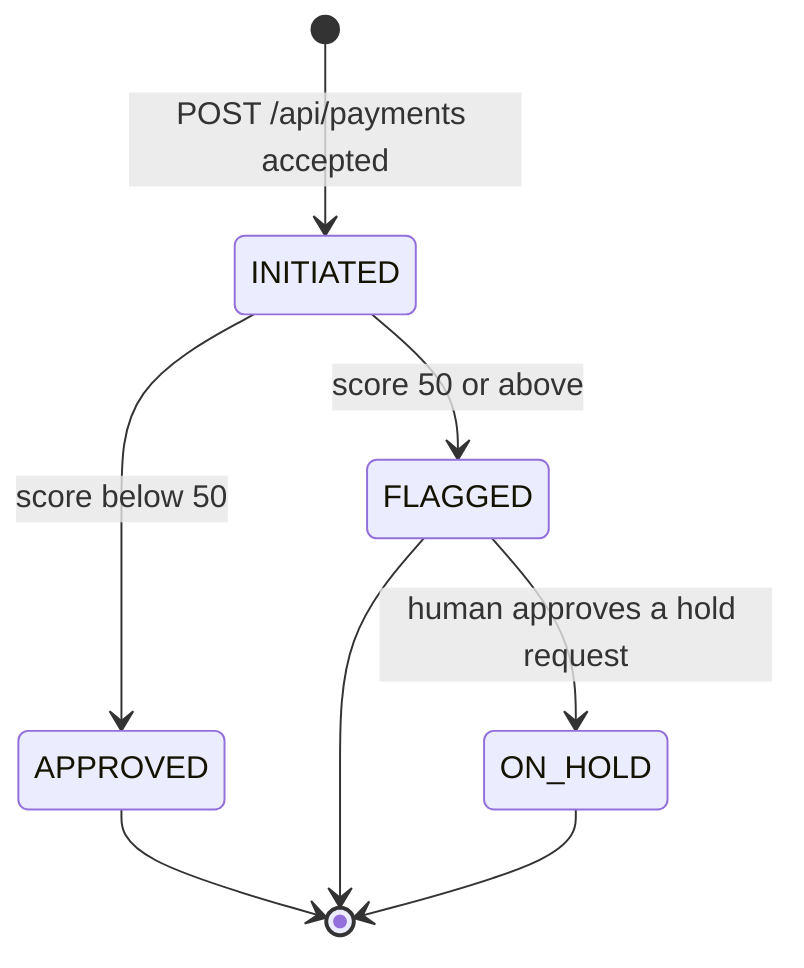
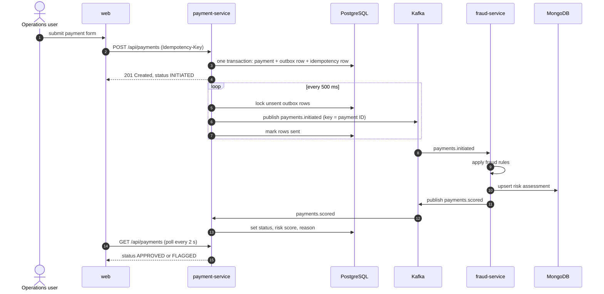
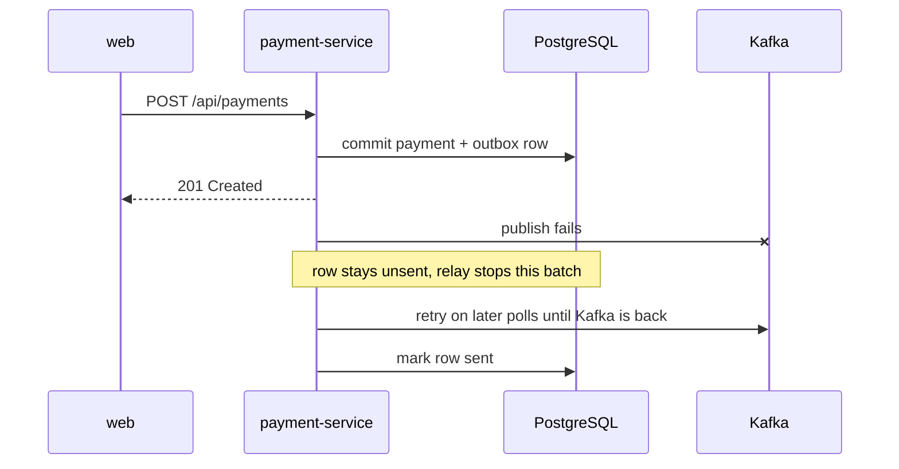
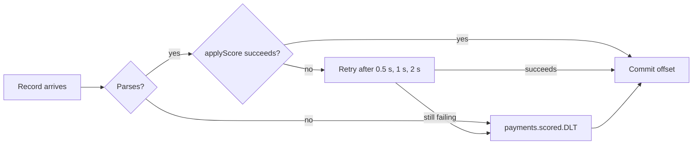
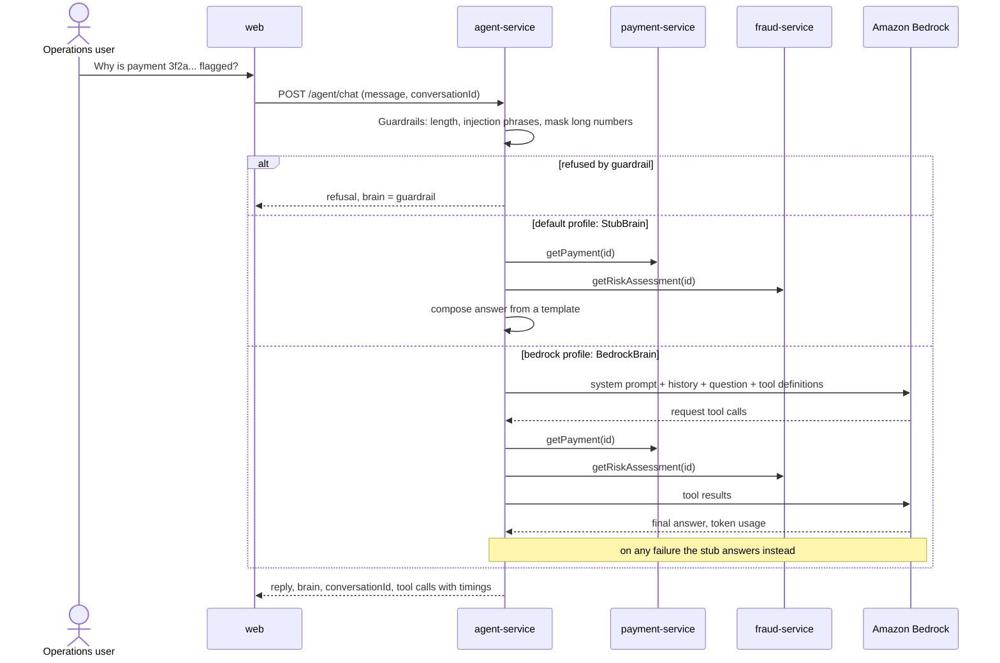
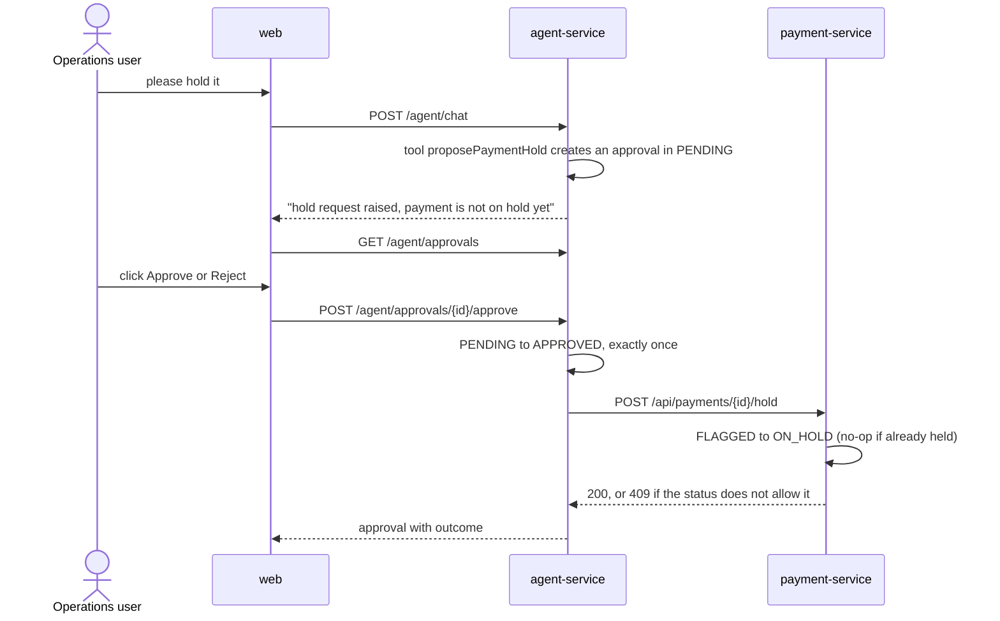

# PayStream project workflow

Two workflows are described here:

- **Part A: runtime workflow.** How a payment and an agent question move through the system, including the failure paths.
- **Part B: development workflow.** How to take one roadmap step from idea to merged code.

For structure, data and design decisions, see `ARCHITECTURE.md`. Part A describes the code as written; it has not yet been run end to end.

---

# Part A: runtime workflow

## A1. Payment lifecycle

A payment is `INITIATED` from the moment it is saved until its score arrives. Only a `FLAGGED` payment can be put on hold, and only after a human approves the agent's request. Releasing or rejecting a held payment is not built yet (roadmap step 8).

## A2. Happy path

Step by step:

1. The user submits the form. The web app generates a new `Idempotency-Key` for this submission.
2. `PaymentController` validates the body. Invalid input returns 400 as problem-detail JSON.
3. `PaymentService.create` writes three rows in one transaction: the payment, an outbox row holding the `PaymentInitiated` event, and the idempotency record.
4. The API returns 201 with the payment. Kafka has not been touched yet.
5. `OutboxRelay` wakes every 500 ms, locks up to 50 unsent rows, publishes each to `payments.initiated`, waits for the broker acknowledgement and marks the row sent.
6. `fraud-service` consumes the event, checks its required fields and runs `FraudRules.score`, which evaluates every `FraudRule`.
7. It upserts the assessment, including the list of rules that fired, into MongoDB with the payment ID as the document ID.
8. It publishes `PaymentScored` to `payments.scored` and waits for the broker's acknowledgement before the offset is committed.
9. `ScoredListener` in `payment-service` consumes it and calls `Payment.applyScore`.
10. The web app's next poll shows the new status and the reason.

## A3. Fraud rules

| Rule | Condition | Points |
|---|---|---|
| High amount | Amount is 100,000 or more | 60 |
| Creditor on watchlist | Creditor account starts with `WATCH` | 50 |
| High velocity | The debtor already made 4 or more other payments in the 60 seconds before this one | 50 |
| Same debtor and creditor | The two accounts are equal | 20 |
| Round amount | Amount is a multiple of 10,000 | 10 |

Points are added and capped at 100. A total of 50 or more gives `FLAGGED`; otherwise `APPROVED`. Every threshold is configuration under `paystream.fraud` in `fraud-service`'s `application.yml`. The velocity count is approximate when one debtor's payments are scored at the same instant.

## A4. Failure paths

### Kafka is down when a payment is created

The user gets a normal 201. The payment stays `INITIATED` until Kafka returns. Nothing is lost.

### The same request arrives twice

| Second request | Result |
|---|---|
| Same key, same body | 200 with the original payment; nothing is written |
| Same key, different body | 422 problem detail |
| Same key, arriving at the same instant | One insert wins on the primary key; the other rolls back and returns the winner's payment with 200 |
| No key | A second payment is created |

### A bad record on either topic

The diagram shows `payments.scored` in `payment-service`. `fraud-service` handles `payments.initiated` the same way, with `payments.initiated.DLT`; there the retried step is "save and publish" and an event with missing fields is treated like one that does not parse.

After a record is dead-lettered the consumer commits and moves on, so later records for other payments are not blocked.

### The same event is delivered twice

Both consumers tolerate it. `fraud-service` overwrites the same MongoDB document and publishes the score again; the velocity rule excludes the payment itself and measures from the event's own time, so a replay does not count a payment against itself. `payment-service` sets the same status and score again.

### Known unhandled cases

- Nobody consumes the dead-letter topics. A payment whose event is dead-lettered stays `INITIATED`.
- If `fraud-service` is down, payments wait in `INITIATED` with no timeout.
- `fraud-service` re-publishes a score when it reprocesses an event, so `payment-service` can see the same score twice. That is harmless today because applying a score is idempotent.

## A5. Agent workflow

Step by step:

1. The web app sends the question with a conversation ID that it keeps for the page session.
2. `Guardrails` refuses blank, over-long or obviously manipulative messages, and masks runs of 12 to 19 digits. Payment IDs are kept.
3. `ToolCallRecorder` starts recording for this request.
4. The brain answers. Every tool it calls validates its arguments, applies timeouts and records its name, input, outcome and duration.
5. The reply carries the answer, which brain produced it, the tool calls and, on Bedrock, token counts. One audit line is logged without the message text.

What each brain can do:

| | StubBrain | BedrockBrain |
|---|---|---|
| Chooses tools by | Keywords and a payment ID in the text | The model's own reasoning |
| Remembers | The last payment per conversation | The last 20 messages per conversation |
| Understands | Explain a payment, list flagged payments, propose a hold | Anything about payments, within the system prompt |
| Cost | None | Tokens per request |
| Status | Unit tests written; neither the tests nor the service have been run | Never compiled or run |

## A6. Hold request workflow

- The agent has no tool that approves a request or holds a payment. Only the approve endpoint reaches `HoldExecutor`.
- One pending request exists per payment; proposing again returns the same request.
- A request can be decided once. A second click gets 409.
- The stub proposes a hold only for a flagged payment and only when the message contains "hold".
- The stub treats "hold", "freeze", "block it" and "stop it" as a request. "Why is it held?" is a question and proposes nothing.
- If the hold call fails after approval, the approval shows the failure and the payment is not held. There is no retry yet.

---

# Part B: development workflow

## B1. Daily run order

1. `docker compose up -d` (Kafka, PostgreSQL, MongoDB)
2. `mvn verify` (build and unit tests)
3. Start `payment-service`, then `fraud-service`, then `agent-service`
4. `cd web && npm run dev`
5. Create one normal and one high-value payment to confirm the slice still works before changing anything

## B2. One roadmap step, start to finish

```mermaid
flowchart LR
  A[Pick the next step] --> B[Read the code it touches]
  B --> C[Write the design in 5 lines<br/>and the options you rejected]
  C --> D[Branch: step-NN-short-name]
  D --> E[Failing test first]
  E --> F[Implement in small commits]
  F --> G[Run the 'done when' check]
  G --> H[ADR if you chose between options]
  H --> I[Update README, ARCHITECTURE,<br/>PROJECT-WORKFLOW]
  I --> J[Pull request, CI green, squash-merge]
```

| Stage | What to do | Time box |
|---|---|---|
| Design | Five lines: the problem, your approach, two alternatives, what gets worse | 15 minutes |
| Test first | One test that fails for the right reason | 20 minutes |
| Implement | Smallest change that passes; commit each working increment | 60 to 90 minutes |
| Prove | Run the step's "done when" check by hand and record the result | 15 minutes |
| Record | ADR if a real choice was made; update the three documents | 15 minutes |

If a step runs past three hours, stop and split it. Commit what works and write down what is left.

## B3. Definition of done for a step

- [ ] `mvn verify` and `npm run build` pass
- [ ] The step's "done when" check passes, and you watched it pass
- [ ] New behaviour has a test; a bug fix has a test that failed before the fix
- [ ] No new TODO without a roadmap step number
- [ ] `ARCHITECTURE.md` failure-mode and gap tables are still true
- [ ] You can explain the change aloud in two minutes, including what you rejected

## B4. Working with AI coding tools

- Ask for the design and the trade-offs before asking for code.
- Implement at least one part of every step yourself, without generated code. Choose the part you understand least.
- Review generated code as you would a junior engineer's pull request: read every line, run it, break it.
- Log each session in `docs/ai-log.md`: what you delegated, what you corrected, what you kept for yourself.

## B5. Conventions

- Branches: `step-04-resilience`. Commits: imperative, one logical change each.
- Squash-merge pull requests into `main`; CI must be green.
- Schema changes only through new Flyway files. Never edit a migration that has run.
- Code conventions are in `CLAUDE.md`.
