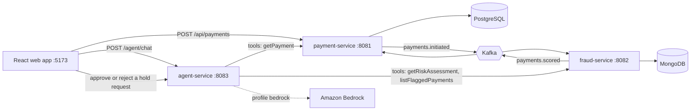

# PayStream

Real-time payments with event-driven fraud scoring and a dispute-triage AI agent.

A learning project. It ships **one thin working slice** and a **14-step roadmap** that you build yourself.
Each step maps to a skill in the target job description (Senior Manager, Java Full Stack Engineering).

Deeper documentation: [`ARCHITECTURE.md`](ARCHITECTURE.md) for structure, data, decisions and failure modes; [`PROJECT-WORKFLOW.md`](PROJECT-WORKFLOW.md) for the runtime flows and how to work a roadmap step.

## The thin slice



1. The web app posts a payment. `payment-service` saves it in PostgreSQL as `INITIATED` together with an outbox row, in one transaction. A relay publishes the row to `payments.initiated`, keyed by payment ID.
2. `fraud-service` consumes the event, runs five rules (including a velocity rule), stores the assessment in MongoDB and publishes `payments.scored`, waiting for the broker to acknowledge.
3. `payment-service` consumes the score and marks the payment `APPROVED` or `FLAGGED`. The web app polls and shows the change.
4. You ask the agent "Why is payment <id> flagged?". It calls read-only tools and answers, showing which tools it used.
   Ask it to hold the payment and it files a request. When you approve it, `agent-service` calls `payment-service` and the payment becomes `ON_HOLD`; the agent cannot do that on its own.
   By default the agent uses an offline stub; with the `bedrock` profile a real model chooses the tools.

## What is verified, and what is not

Be clear about this before you rely on anything here.

| Part | Status |
|---|---|
| Web app (`web/`) | Type-checked and built successfully with `npm run build`. |
| Java code (3 services) | **Written but never compiled.** This includes the outbox, dead-letter and idempotency code in `payment-service` and the rule engine in `fraud-service`. Only the stateless fraud rules were compiled, against stub annotations. The environment it was written in could not reach Maven Central. Your first task is `mvn verify`; expect to fix a few small things. |
| Dependency versions | Spring Boot 3.5.6 and Spring AI 1.1.0 are pinned from memory, not checked against Maven Central. Bump them to the latest patch releases. |
| `agent-service` plain classes | `Guardrails`, `ApprovalStore` and `ToolCallRecorder` were compiled and exercised with a small harness. |
| `agent-service` start-up without AWS | Relies on `spring.ai.model.chat=none`. If it fails to start, see Troubleshooting. |
| `BedrockBrain` | Never compiled, never run against AWS. Lines that depend on the exact Spring AI version are marked `API check`. |
| Docker Compose, Dockerfile, Helm chart, CI workflow | YAML is valid. None has been run. |

## Run it

Prerequisites: JDK 21, Maven 3.9+, Node 20+, Docker Desktop.

```bash
# 1. Infrastructure: Kafka, PostgreSQL, MongoDB
docker compose up -d

# 2. Build and unit-test the backend (do this first; fix anything that does not compile)
mvn verify

# 3. Three terminals, one service each
mvn -pl payment-service spring-boot:run
mvn -pl fraud-service spring-boot:run
mvn -pl agent-service spring-boot:run

# 4. Web app
cd web
npm install
npm run dev        # http://localhost:5173
```

Try it:

- Send 2,500 INR to `ACC-2002`: the status moves from `INITIATED` to `APPROVED` within a second or two.
- Send 250,000 INR, or pay a creditor starting with `WATCH`: it becomes `FLAGGED`.
- Send five small payments from the same debtor within a minute: the fifth is `FLAGGED` for high velocity.
- Click a payment ID to copy it, then ask the agent: `Why is payment <paste id> flagged?`
- Follow up with `please hold it`: a hold request appears under the agent panel. Approve it and the payment's status changes to `ON HOLD` in the table within two seconds. Only a `FLAGGED` payment can be held.
- Ask `which payments are flagged?` with no ID.

Without the web app:

```bash
curl -X POST localhost:8081/api/payments -H "Content-Type: application/json" -H "Idempotency-Key: demo-1" \
  -d '{"debtorAccount":"ACC-1","creditorAccount":"WATCH-9","amount":250000,"currency":"INR"}'
curl localhost:8081/api/payments
curl -X POST localhost:8083/agent/chat -H "Content-Type: application/json" \
  -d '{"message":"Why is payment <id> flagged?","conversationId":"demo"}'
curl localhost:8083/agent/approvals
```

### Run the agent on Amazon Bedrock (optional, costs a little)

```bash
export AWS_REGION=us-east-1
export BEDROCK_MODEL_ID=<a model or inference-profile ID enabled in your account>
export SPRING_PROFILES_ACTIVE=bedrock
mvn -pl agent-service spring-boot:run
```

On Windows PowerShell use `$env:NAME="value"` instead of `export`.

Before the first run:

1. In the Bedrock console, enable access to a model that supports tool use, in the region you set.
2. Give your AWS identity `bedrock:InvokeModel` and `bedrock:InvokeModelWithResponseStream` on that model (and on the inference profile, if you use one).
3. Compile. `BedrockBrain` was written from memory of the Spring AI 1.x API; fix any line marked `API check` that does not compile against your version.
4. Ask the same three questions you asked the stub and compare the answers and the tool calls.

If the model call fails at runtime, the service answers with the stub and labels the reply `stub (Bedrock unavailable)`; the reason is in the `agent-service` log.

## Project layout

```
paystream/
  pom.xml                  parent POM: Spring Boot and Spring AI versions
  payment-service/         REST API, PostgreSQL (JPA + Flyway), Kafka producer and consumer
  fraud-service/           Kafka consumer and producer, rules, MongoDB
  agent-service/           AgentBrain port, StubBrain, BedrockBrain (Spring AI), tools, guardrails, approvals, audit
  web/                     React + TypeScript + Vite
  docker-compose.yml       Kafka (KRaft), PostgreSQL, MongoDB
  Dockerfile               one multi-stage build for all three services
  deploy/helm/             Helm chart for payment-service
  infra/terraform/         empty; roadmap step 13
  .github/workflows/ci.yml build and test on every push
  ARCHITECTURE.md          containers, events, data model, decisions, failure modes
  PROJECT-WORKFLOW.md      runtime workflows and the development workflow
  CLAUDE.md                conventions for AI coding assistants
  docs/adr/                architecture decision records
```

## JD skill map

| JD requirement | In the slice today | You build it in step |
|---|---|---|
| Java, Spring Boot, microservices | Three services, REST, validation, JPA | 1, 3, 4 |
| Apache Kafka, event-driven architecture | Keyed events, two consumer groups, outbox relay, dead-letter topic | 1, 2, 5, 6 |
| Real-time data processing pipelines | Consume, score with five rules, publish with acknowledgement | 6 |
| Building AI agents, agentic AI on AWS | Tool-calling agent, conversation memory, guardrails, tool-call audit, human-approved action, Bedrock adapter with fallback | 7, 8 |
| Relational database | PostgreSQL with Flyway; outbox and idempotency tables | 1, 3 |
| NoSQL | MongoDB: embedded rule hits, compound index, count query | 6 |
| Frontend (React) | Form, live table, agent panel with tool trace and approval queue | 9 |
| Docker | Dockerfile, Compose for infrastructure | 10 |
| CI/CD and DevOps | GitHub Actions build | 11 |
| Kubernetes | Helm chart for one service | 12 |
| Cloud-native services | none yet | 13 |
| Security, performance | none yet | 4, 14 |
| AI-assisted development | `CLAUDE.md`, Copilot instructions | every step |

## Roadmap: 14 steps, each one to three hours

Do them in order. Each has a definition of done. Write a short ADR in `docs/adr/` for any step where you chose between options.
Commit after every step; the commit history is part of the portfolio.

**Step 0. Make it compile and run.** `mvn verify` is green; all three services start; you have created a payment in the UI and seen it scored. Bump Spring Boot and Spring AI to the latest patch versions.

**Steps 1 to 3 are already implemented in `payment-service`, and step 2 also in `fraud-service`** (see ADRs 0002 and 0003). They are not yet proven: finish each one with the exercise below.

**Step 1. Transactional outbox (implemented; prove it).** `PaymentService.create` writes the payment and an `outbox` row in one transaction; `OutboxRelay` publishes unsent rows every 500 ms using `FOR UPDATE SKIP LOCKED`.
*Your exercise:* write a Testcontainers integration test (`OutboxIT`) that stops Kafka, creates a payment, restarts Kafka and asserts the event arrives. Then add clean-up of sent rows and a gauge for unsent rows.

**Step 2. Error handling and dead-letter topics (implemented in both services; prove it).** Each `KafkaConfig` retries a failing record 3 times with backoff, then publishes it to `<topic>.DLT`.
*Your exercise:* publish a malformed message to `payments.initiated` with the Kafka console producer and find it on `payments.initiated.DLT` with its exception headers. Then build a small DLT consumer that logs each dead letter and exposes a count metric, and decide how a record would be replayed.

**Step 3. Idempotent API (implemented; prove it).** `POST /api/payments` accepts an `Idempotency-Key` header: a repeat returns the original payment with 200, and the same key with a different body returns 422.
*Your exercise:* write a test that fires 20 concurrent requests with one key and asserts exactly one payment and one outbox row exist. Then add expiry for old keys.

**Step 4. Resilience and a shared error contract.** Add Resilience4j (timeout, retry, circuit breaker) to the agent's two HTTP tools, and a `@RestControllerAdvice` returning `ProblemDetail` in each service.
*Done when:* stopping `fraud-service` makes the agent answer in under two seconds with a clear message.

**Step 5. Event schemas.** Replace JSON strings with Avro or JSON Schema and a schema registry in Compose. Make one backward-compatible change and one that the registry rejects.
*Done when:* the incompatible change fails at build or publish time.

**Step 6. A real stream: exact velocity.** `VelocityRule` counts in MongoDB today, which is approximate under concurrency. Replace it with a Kafka Streams windowed count on a stream re-keyed by debtor. Start two `fraud-service` instances and watch the rebalance.
*Done when:* twenty payments from one debtor sent in parallel flag every payment after the fourth, which the MongoDB version cannot guarantee.

**Step 7. Run the agent on Bedrock (code written; make it work).** `BedrockBrain`, conversation memory, the tool-call trace and the stub fallback are written but have never run. Get it compiling, run it, then persist the audit trail and the chat memory.
*Done when:* the same three questions work on stub and on Bedrock, you can show the tool calls the model chose, and you have written 10 test questions with expected answers and scored the model against them.

**Step 8. Harden the guarded action (hold works end to end; the rest is yours).** Approving a request now calls `POST /api/payments/{id}/hold` and the payment becomes `ON_HOLD`. Still to build: a release action (`ON_HOLD` back to `APPROVED`, or a new `REJECTED`), a `PaymentHeld` event through the outbox, persisted approvals, a retry when the hold call fails after approval, Amazon Bedrock Guardrails, and screening of tool results for injected instructions.
*Done when:* a held payment can be released by a human, an approval survives a restart, and a payment whose risk reason contains an injected instruction does not change the agent's behaviour.

**Step 9. Frontend depth.** Replace polling with Server-Sent Events; add routing, a payment detail page with its risk assessment, loading and error states, and component tests with Vitest.
*Done when:* a status change appears in the browser without a refresh or a poll.

**Step 10. Containerise everything.** Add the three services and the web app to Compose using the Dockerfile. Add a second Kafka listener so containers and your host can both connect.
*Done when:* `docker compose up` on a clean machine gives a working system.

**Step 11. A real pipeline.** Add JaCoCo with a coverage gate, a static-analysis step, dependency scanning, image build and push, and Testcontainers integration tests (`*IT`) for the Kafka flow.
*Done when:* a pull request that drops coverage or adds a vulnerable dependency fails.

**Step 12. Kubernetes.** Install the Helm chart on a local cluster (kind or minikube). Copy the chart for the other two services. Add an HPA, a PodDisruptionBudget and a Secret for the database password. Do a rolling update and a rollback.
*Done when:* you can kill a pod during a load test with no failed requests.

**Step 13. Cloud.** Write the Terraform described in `infra/terraform/README.md` and deploy once to AWS. Destroy it afterwards.
*Done when:* `terraform apply` from an empty account gives a running system, and `terraform destroy` leaves nothing behind.

**Step 14. Security, observability, performance.** OAuth2 resource server on all APIs; Micrometer metrics with Prometheus and Grafana; OpenTelemetry tracing across the Kafka hop; a JMeter or k6 test with p95 and p99 before and after one optimisation.
*Done when:* one trace shows HTTP, Kafka and database spans for a single payment, and you can state the system's throughput with evidence.

## Working with AI coding tools

The JD asks for AI-assisted development. Use this project to build a practice you can describe:

- `CLAUDE.md` and `.github/copilot-instructions.md` hold the conventions, so every assistant produces consistent code.
- For each roadmap step, ask the assistant for a design and trade-offs first, then implement in small commits with tests.
- Keep a `docs/ai-log.md`: what you delegated, what you corrected, what you would not delegate. That log is your interview answer.

## Troubleshooting

- **`BedrockBrain` does not compile.** Check the four things marked `API check` against the Spring AI reference for your version: the `MessageWindowChatMemory` builder, `MessageChatMemoryAdvisor.builder`, the `ChatMemory.CONVERSATION_ID` advisor parameter, and `getText()` / `getPromptTokens()` on the response. If you are stuck, delete the memory advisor lines first; the agent still works without memory.
- **`agent-service` fails at start-up with a Bedrock or credentials error in the default profile.** The properties that switch the model off may be named differently in your Spring AI version. Quick fix: move the `spring-ai-starter-model-bedrock-converse` dependency into a Maven profile, or exclude the Bedrock auto-configuration classes named in the stack trace.
- **`Schema-validation: wrong column type`.** Hibernate and the Flyway script disagree. Fix the migration in a new `V2` file, not by editing `V1` once it has run.
- **Consumers receive nothing.** Check that Kafka is reachable on `localhost:9092` and the topics exist: `docker compose exec kafka /opt/kafka/bin/kafka-topics.sh --bootstrap-server localhost:9092 --list`.
- **Port already in use.** Change `server.port` in the service's `application.yml` and the proxy in `web/vite.config.ts`.
